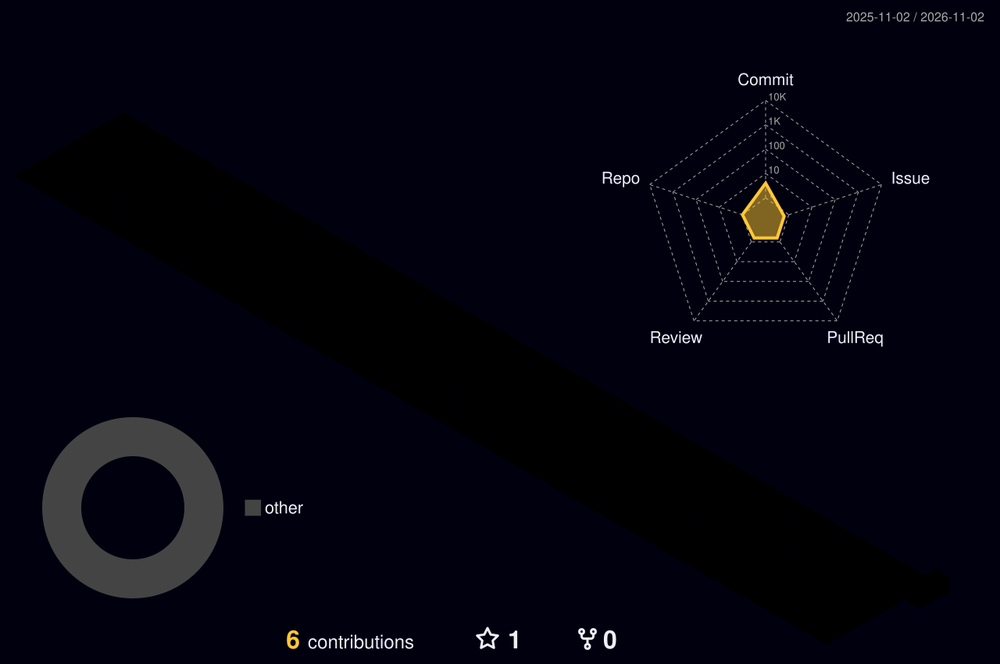

<!-- ═══════════════ ABOUT ME ═══════════════ -->

## About Me

Hi there! 👋 I'm **Ankit Kumar Choubey**.

🎓 BCA Student at **Maharishi University of Information Technology, Lucknow**  
📅 Expected Graduation: **2027**  
🎯 Career Goal: **Data Analyst**

I am passionate about exploring data, discovering insights, and solving real-world problems using technology. I am interested in **Python, SQL, Data Analytics, and Artificial Intelligence**. I continuously work on improving my technical and analytical skills.

---

## 3D Contribution Graph

  

---

## Contribution Snake

  <picture>
    <source media="(prefers-color-scheme: dark)"
            srcset="https://raw.githubusercontent.com/kochasashish-ops/kochasashish-ops/output/github-snake-dark.svg" />
    <source media="(prefers-color-scheme: light)"
            srcset="https://raw.githubusercontent.com/kochasashish-ops/kochasashish-ops/output/github-snake.svg" />
    
  </picture>

---

## Tech Stack

  

  
  
  
  

---

## Data Visualization

  
  
  

---

## Database

  
  

---

## Office & Productivity

  
  
  
  

